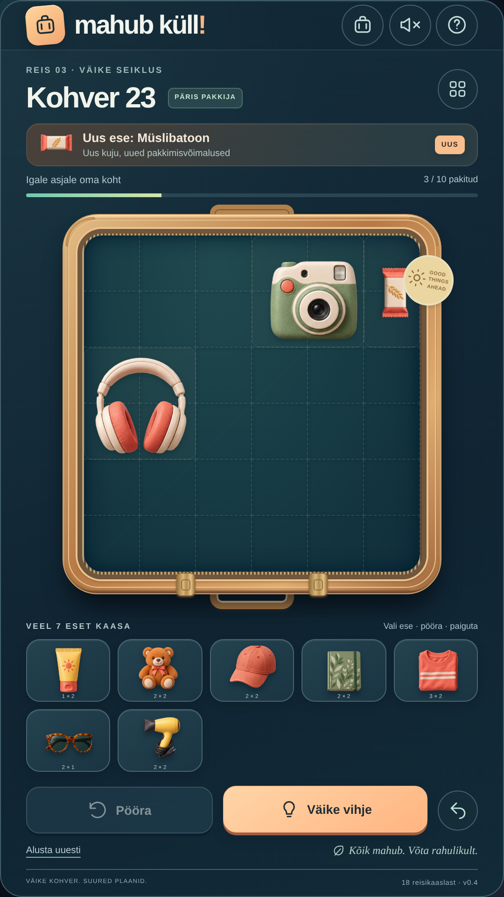

# Suitcase — Mahub küll!

Eestikeelne telefonile mõeldud kohvri pakkimise pusle, mida saab arvutis brauseriga testida. Lohista ja pööra esemeid, kuni kõik kohvrisse mahub. Suitcase sisaldab varasema mängu lähtekoodi, graafikat, teste ja Androidi projekti.

Versioonis 0.4 on:

- 24 lahendatavat taset ja iga päev uus pusle.
- 18 eset; kampaanias avaneb uus ese iga 1–2 taseme järel.
- Tume sügavsinine ja türkiissinine kujundus, oranžid nupud ning selged valikurõhutused.
- 9:16 püstvaade ka arvutis, 1080 × 1920 pildi eksport.
- Hiire- ja puutejuhtimine, pööramine, vihjed, tagasivõtmine ja esemekogu.
- Edenemise JSON-varukoopia salvestamine ja taastamine teises brauseris või seadmes.
- Võrguühenduseta veebimäng ja Capacitoriga Androidi proovipakett.



## Veebis proovimine

**[Ava mäng brauseris](https://m2gn3tic-byte.github.io/Suitcase/)**

GitHub Pagesi [avaldamistöö](https://github.com/m2gn3tic-byte/Suitcase/actions/runs/40878288737) lõppes edukalt 29.10.2026. Mäng avaneb ka arvutis 9:16 püstvaatena. Pilve võrgupoliitika ei luba avaliku lehe HTTP-vastust siin kontrollida; tootmisversiooni mängimist, faile ja alamkataloogi testiti kohalikus brauseris.

Alternatiiv: **[arvuti prooviversioon ZIP-ina](https://github.com/m2gn3tic-byte/Suitcase/archive/refs/heads/playtest.zip)**. Paki lahti ja ava `Mahub-kull.html`. Allalaadimine ja testitud failiga kokkulangevus on kontrollitud. Juhend: [docs/TESTIMINE.md](docs/TESTIMINE.md).

## Arendamine

Kasuta Node.js 24 ja olemasolevat checkout'i `/workspace/Suitcase`. Pilveülesanne on juba eraldatud; uut Git worktree'd pole vaja.

```sh
cd /workspace/Suitcase
npm ci --no-audit --no-fund
npm run dev -- --port 5173 --strictPort
```

Mäng ei vaja andmebaasi, kontot, API-võtit ega taustateenust. Kohalik server on arendamiseks ja automaattestideks. Pilvekeskkonna failitee või serveri port ei ole kasutajale avalik mängulink.

## Kontrollid ja prooviversioonid

```sh
npm test
npm run test:e2e
npm run build:pages
npm run android:build
```

Mootori- ja salvestustestid kontrollivad tasemete lahendatavust, esemete avanemist, paigutusreegleid ning varukoopia valideerimist. Playwright käivitab arvuti- ja telefonivaate kontrollid koos kohalike serveritega pordil 5173, 4173 ja 4273. Testitakse ka päris hiire- ja puuteliigutusi, edenemise säilimist, varukoopia allalaadimist ja teises päritolus taastamist, võrguühenduseta mängimist ning `/Suitcase/` alamkataloogi. Testid vajavad Chromiumi: siin on `/usr/bin/chromium`, mujal kasuta `npx playwright install chromium` või määra `CHROMIUM_PATH`.

`npm run build:standalone` loob kogu graafikat ja koodi sisaldava faili `artifacts/Mahub-kull.html`. Arvutisse edastatud faili saab avada Chrome'i, Edge'i või Firefoxiga. `npm run build:pages` loob lisaks veebiversiooni kataloogi `dist-pages/`, arvestades Suitcase'i tõstutundlikku aadressiosa `/Suitcase/`.

`npm run android:build` sünkroonib praeguse mängu Androidi projekti, ehitab ja kontrollib APK allkirja. Tulemus on `artifacts/mahub-kull-debug.apk`. Päris Androidi telefonis mängimine vajab eraldi seadmetesti.

Ehituskäsud üksi ei avalda versiooni GitHubis. Avaldamiseks on eraldi loaga kasutatav `npm run publish:playtest` ja ainult käsitsi käivituv GitHub Actionsi töövoog. Enne avaldamist tuleb ka lähtekood Suitcase'i hoidlasse salvestada. Juhend: [docs/TESTIMINE.md](docs/TESTIMINE.md).

## Edenemine ja varukoopia

Edenemine säilib brauseri kohalikus salvestusruumis. Ava **Vali tase → Edenemise varukoopia → Salvesta varukoopia**, et saada JSON-fail. Teises mängu asukohas vali samast menüüst fail, vaata eelvaadet ja vajuta **Taasta varukoopia**.

Taastamisel liidetakse läbitud tasemed. Sama kohvri pooleliolev paigutus võetakse varukoopiast; teised kohvrid säilivad. Vigane fail või salvestusruumi tõrge ei muuda praegust mängu. Sama mänguformaadiga vanad paigutused töötavad edasi; muutunud taseme paigutus alustab algusest, läbitud tasemed säilivad. Automaatsed pilvesalvestused ja kasutajakontod puuduvad.

## Võrguühenduseta kasutamine

Ava tootmisversioon esmalt võrguga ja lase failidel vahemällu laadida. Seejärel saab sama aadressi võrguühenduseta avada. Service worker eeldab HTTPS-i või kohalikku arendusmasinat; arendusrežiimis seda ei registreerita. Iseseisev HTML-fail ei vaja service worker'it ega võrku. Muutes vahemällu salvestatud failide sisu, suurenda `public/sw.js` vahemälu versiooni.

## Android ja Google Play

Rakenduse identifikaator on `ee.mahubkull.game`, versioon 0.4.0. Androidi projekt asub `android/`, veebifailid `dist/`. Täis-JDK 21 ja SDK asuvad pilves hoidlast väljaspool. Täpne juhend ja tööriistade päritolu: [docs/ANDROID.md](docs/ANDROID.md).

Mäng on prototüüp. Google Play väljalase, väljalaske allkirjastus, poe materjalid ja kehtiva siht-API nõude kontroll on eraldi töö. Makseid, reklaame ega analüütikat pole lisatud; allkirjastusvõtmed hoia hoidlast väljas.
